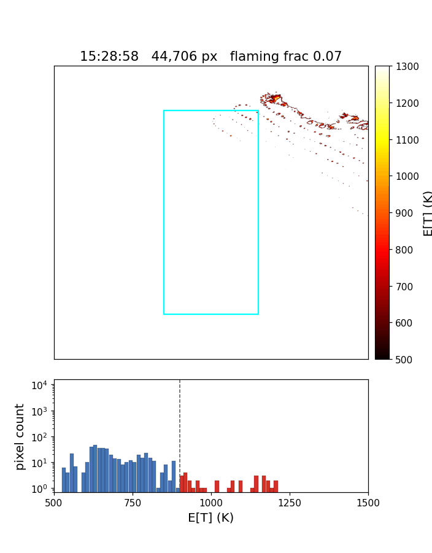

# ISOFire 🔥🛰️

This is the official implementation of

## [Real-time physics inversion for retrieval of sub-pixel wildfire temperatures from VSWIR imaging spectroscopy](https://arxiv.org/abs/2608.07580)

by *William Keely et al.* from NASA Jet Propulsion Laboratory, California Institute of Technology

## Introduction

ISOFire retrieves sub-pixel wildfire temperature from VSWIR imaging spectroscopy, applied to NASA's AVIRIS-3. A full-physics forward model resolves both solar and emitted radiance from a temperature distribution and fits the full spectral range.

The retrieval fits a two-component (hot + smoldering) Gaussian temperature mixture per pixel and reports the analytic moment-matched single Gaussian: `mu` = effective fire temperature E[T] in Kelvin, and `sigma` = its uncertainty. The solver is a batched two-stage Adam optimizer written in JAX, fast enough on a GPU to run within flight cadence.



Two entry points share the same retrieval:

| | `isofire.onboard` | `isofire.airborne` |
|---|---|---|
| Use | flight operations | post-processing and analysis |
| Inputs | RDN, LOC, BANDMASK, OBS | RDN, LOC, GLT, BANDMASK, OBS |
| Output | unwarped ENVI pairs for a downstream ortho step | orthorectified GeoTIFF (COG) |

| Module | Role |
|---|---|
| `isofire.rt` | Physics: 6S templating and parsing, spectral resampling, emissive radiance. |
| `isofire.retrieval` | Algorithms: water vapor, endmembers, masks, the mixture solver, moment matching. |
| `isofire.airborne` | Scene watcher, ortho warp, GeoTIFF output. Shared I/O helpers. |
| `isofire.onboard` | Scene watcher for flight operations, pre-ortho ENVI output. |

## Installation

We use [uv](https://docs.astral.sh/uv/).

```
git clone https://github.com/isofit/isofire.git
cd isofire
uv sync                      # CPU JAX
uv sync --extra cuda12       # GPU JAX (recommended)
```

## Build 6S

The retrieval calls a 6S Fortran binary as a subprocess. [6sMultiComponent](https://github.com/isofit/6sMultiComponent) is vendored under `sixs/`, so a fresh clone has everything it needs. Requires `gfortran`.

```
cd sixs/Sixs
make FFLAGS="-O -ffixed-line-length-132 -std=legacy -fno-pie -no-pie"
cd ../..
export ISOFIRE_SIXS_DIR=$PWD/sixs/Sixs
```

The `-fno-pie -no-pie` flags are required on modern Linux toolchains; without them the link step fails with `relocation R_X86_64_32 against '.data' can not be used when making a PIE object`. The resulting `sixs/Sixs/sixsV2.1` is platform-specific and gitignored, so each clone builds its own.

## Data files

The fire endmember library, Kurudz solar irradiance, and AVIRIS-3 wavelength/FWHM cache ship inside the package at `src/isofire/data/`. Resolution order is the CLI flag, then `$ISOFIRE_DATA_DIR`, then the packaged copy.

AVIRIS-3 L1B scenes are publicly available from the [AVIRIS-3 data portal](https://popo.jpl.nasa.gov/avcl/). A scene is processed once all of its ENVI pairs are present in the input directory, grouped by scene id (`AV3<date><time>[_<chunk>]`).

## Usage

Onboard (flight operations; pre-ortho ENVI products):

```
uv run python -m isofire.onboard \
    --input_dir     /path/to/l1b \
    --to_ortho_dir  results/to_ortho
```

Airborne (orthorectified GeoTIFFs, used for the results in the paper):

```
uv run python -m isofire.airborne \
    --input_dir          /path/to/l1b \
    --fire_temp_dir      results/fireTemp \
    --fire_temp_unc_dir  results/fireTempUnc
```

Both are watchers: they poll the input directory and process each scene as its files land. `run_isofire.sh` is a SLURM example with the tuned defaults from the paper. See `--help` for the full flag list.

## Outputs

| Product | Units | Contents |
|---|---|---|
| `<scene_id>_fireTemp` | K | effective fire temperature, E[T] |
| `<scene_id>_fireTempUnc` | K | 1-sigma uncertainty |

In-scene pixels that were not retrieved carry `-1`; out-of-swath pixels in the orthorectified products carry `0`. Retrieved values are strictly positive, so both sentinels are unambiguous.

## Citation

If you use this code, please cite us:

```
@article{keely2026realtime,
  title={Real-time physics inversion for retrieval of sub-pixel wildfire temperatures from VSWIR imaging spectroscopy},
  author={Keely, William R.},
  journal={arXiv preprint arXiv:2608.07580},
  year={2026}
}
```

## Acknowledgements

This research was carried out at the Jet Propulsion Laboratory, California Institute of Technology, under a contract with the National Aeronautics and Space Administration. A portion of this work was funded by NASA ROSES 80NM0018F0590 and by Realtime Active Fire Data from NASA's AVIRIS-3 Sensor for Fire Operations 80NSSC25K0225. AVIRIS-3 is sponsored by the NASA Earth Science Division.

We thank the 6S team for their work; see the [official 6S site](https://salsa.umd.edu/6spage.html) for documentation and the canonical source.

Licensed under Apache-2.0. The vendored 6S radiative transfer code in `sixs/` is distributed under its own terms.